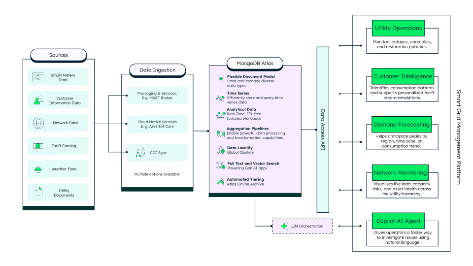
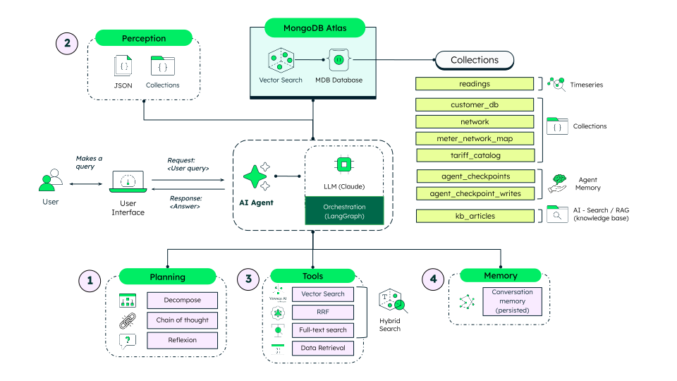

# Smart Grid Management Platform

This demo shows how a utility can turn raw smart-meter data into real-time
operational decisions on a single MongoDB Atlas data layer. It brings several
grid workloads together over the same smart-meter data:

- **Monitoring Panel** - outages, grid/feeder stability, anomalies, power factor, live readings, and a customer/outage map.
- **Network Center** - the grid topology (utility → substation → feeder → transformer), substation health, capacity pressure, and outage status.
- **Customers** - profile, latest reading, tariff recommendation, insights, appliance breakdown, usage segment, and consumption trend.
- **Forecasting** - expected demand and peak timing per region, weather-adjusted with external data, plus the exact aggregation pipeline behind it.
- **Time-Series Explorer** - a guided walkthrough of the aggregation pipelines that query the high-frequency `readings` time-series collection.
- **Queryable Encryption** - a six-step walkthrough showing how sensitive fields stay encrypted on the server yet remain equality- and range-queryable.
- **Grid Support Agent** - a LangGraph multi-agent chatbot that answers questions over the data and a knowledge base using hybrid search.

Most cards expose a `{ }` **"Show document"** button that reveals the real
documents and aggregation pipelines powering them.

## Where MongoDB Shines

- **Atlas Time Series** - high-frequency smart-meter readings stored and queried efficiently.
- **Aggregation Framework** - analytics run in the database: `$setWindowFields`/`$shift` (gaps-and-islands outage detection), `$lookup` across the grid topology for utilization, and `$group` with `$stdDevSamp` for anomalies and forecasting.
- **Flexible document model** - meters, customers, and the grid hierarchy live as related documents joined on demand; the schema evolves without migrations.
- **Change Streams** - a derived `latest_readings` collection (time-series collections don't support change streams) drives the live panels over SSE.
- **Queryable Encryption** - sensitive fields (SSN, billing amount) are encrypted client-side and stored as ciphertext, while equality and range queries still run server-side.
- **Atlas Vector Search with automated Voyage AI embeddings** - semantic search with no separate embedding service.
- **Hybrid search** - vector + full-text results fused with Reciprocal Rank Fusion (RRF).
- **Agentic AI on MongoDB** - a LangGraph multi-agent with conversation memory persisted in Atlas (`agent_checkpoints`).

## High Level Architecture

The platform combines two architectures on a single Atlas cluster: an
**operational data layer** (monitoring, network, forecasting, customers) and an
**agentic AI layer** that lets users query it all in natural language.

### Operational data layer


### Agentic AI layer


## Tech Stack

- Next.js [App Router](https://nextjs.org/docs/app) for the framework and API routes
- [MongoDB Atlas](https://www.mongodb.com/atlas/database) for the database, search, and agent memory
- [LangGraph.js](https://langchain-ai.github.io/langgraphjs/) for the multi-agent orchestration
- [Anthropic Claude](https://www.anthropic.com/) as the LLM and [Voyage AI](https://www.voyageai.com/) for embeddings
- [amCharts](https://www.amcharts.com/) and [LeafyGreen UI](https://www.mongodb.design/) for the interface

## Prerequisites

Before you begin, ensure you have the following:

- **Node.js 22** or higher
- A **MongoDB Atlas** account with a cluster (**M10 or higher** - required for Atlas Vector Search with automated embeddings)
- **Python 3.13** and **[uv](https://docs.astral.sh/uv/)** - used by the data pipeline that generates and loads the operational collections
- An **Anthropic API key** (the AI assistant uses Claude)
- A **Voyage AI API key** (used by the Vector Map visualization)

## Run it Locally

### 1. Clone the repository

```bash
git clone https://github.com/mongodb-industry-solutions/smart-grid-platform.git
cd smart-grid-platform
```

### 2. Install dependencies

The app (frontend) and the data pipeline (backend). The pipeline runs via `uv`
in the **backend** service, and the header's feeder toggle calls that service to
start/stop the live stream, so install both up front:

```bash
cd frontend && npm install
cd ../backend && uv sync          # data-pipeline deps (pandas, pymongo, ...)
```

### 3. Configure environment variables

Create a `.env.local` file inside the `frontend` folder:

```bash
MONGODB_URI=<YOUR_MONGODB_ATLAS_CONNECTION_STRING>
DATABASE_NAME=<YOUR_DATABASE_NAME>

# AI assistant - Claude via the standard Anthropic API
ANTHROPIC_API_KEY=<YOUR_ANTHROPIC_API_KEY>
# Optional: override the default model (claude-haiku-4-5)
# ANTHROPIC_MODEL=claude-haiku-4-5

# Vector Map visualization - direct Voyage AI embeddings
VOYAGE_API_KEY=<YOUR_VOYAGE_API_KEY>
```

> **MongoDB internal users** can instead point the assistant at the Grove gateway
> by setting `GROVE_API_KEY` (and optionally `GROVE_ANTHROPIC_URL`). When those are
> absent, the app uses the standard Anthropic API above.

The Queryable Encryption explorer needs two extra variables - see
[Queryable Encryption demo](#queryable-encryption-demo) below.

If you need help getting your Atlas connection string, see
[Connect to your cluster](https://www.mongodb.com/docs/atlas/tutorial/connect-to-your-cluster/).

### 4. Start the app

From the `frontend` folder:

```bash
npm run dev
```

The app is now available at **http://localhost:3000** and redirects to the
Monitoring Panel.

### 5. Start the backend

The **feeder toggle** in the app header starts/stops the Python feeder in the
backend service, so start it too. From the `backend` folder:

```bash
uv run uvicorn main:app --port 8000
```

The frontend reaches it at `BACKEND_URL` (defaults to `http://localhost:8000`).
If you only want to seed from the CLI (see below), you can skip this.

### 6. Seed the data and start the live feeder

The operational data is generated in code - 6 days of 15-minute readings for 250
meters - and loaded into Atlas as a time-series collection with indexes. The
loader **shifts the timestamps to "now"**, so there is no daily regeneration to
run: seed once and the data stays current.

From the `backend` folder (or `make seed_data` from the repo root):

```bash
uv run scripts/data_pipeline/pipeline.py         # generate 6 days of history
uv run scripts/data_pipeline/load_to_mongo.py    # load it into Atlas (timestamps shifted to now)
```

Then seed the AI knowledge base (needed by the Grid Support Agent), from the
`frontend` folder:

```bash
node --env-file=.env.local scripts/seedKnowledgeBase.mjs
```

> Atlas builds search indexes asynchronously, so the AI assistant's sources may
> take an extra minute to appear.

Finally, click the **Feeder Off** toggle in the app header (or run `make feeder`)
to start the live stream. The feeder appends one fresh reading per customer every
tick, on top of the seeded history - that's what makes the live panels move. It
has built-in guards so it can't overflow the collection or run forever
(`--retain-days`, default 35; `--max-hours`, default 2).

## Queryable Encryption demo

The **Queryable Encryption** page walks through six steps: a plaintext record,
the exposure, the encrypted record, an equality search, a range query, and why
it matters. It reads a second collection (`customer_db_encrypted`) whose `ssn`
and `billing_amount` fields are encrypted with MongoDB Queryable Encryption.

Setup requires the `crypt_shared` library (automatic encryption uses it for query
analysis) and a local KMS master key:

1. Download `crypt_shared` for your platform from the MongoDB Enterprise
   downloads (`mongo_crypt_shared_v1-<platform>.tgz`) and place
   `lib/mongo_crypt_v1.*` in `backend/.crypt_shared/` (or point `CRYPT_SHARED_PATH`
   at it). The Docker image already bundles it at `/opt/crypt_shared`.
2. Run the setup script against the **same cluster the app reads**. It enriches
   `customer_db` with synthetic PII and creates the encrypted collection:

   ```bash
   cd backend
   uv run scripts/setup_qe.py --uri "<MONGODB_URI>" --db "<DATABASE_NAME>"
   # or, to reuse frontend/.env.local: uv run scripts/setup_qe.py --from-env
   ```

   The script writes `backend/qe_encrypted_fields.json` (the `encryptedFields`
   config). Copy it to `frontend/lib/const/qeEncryptedFields.json` so the app can
   build the same `encryptedFieldsMap`.

Then set these in `frontend/.env.local` (and in the deployed environment's
secrets):

| Variable | Description |
| --- | --- |
| `QE_MASTER_KEY` | Hex-encoded 96-byte local KMS master key (from `backend/qe_masterkey.txt`). **Never commit it.** |
| `CRYPT_SHARED_PATH` | Path to the `crypt_shared` library (bundled in the Docker image). |

Without them, the equality and range steps return a configuration error.

## Environment variables

| Variable | Where | Required | Description |
| --- | --- | --- | --- |
| `MONGODB_URI` | `frontend/.env.local` | Yes | Atlas connection string. Used by the app **and** the data pipeline. |
| `DATABASE_NAME` | `frontend/.env.local` | Yes | Target database name. Used by the app **and** the data pipeline. |
| `ANTHROPIC_API_KEY` | `frontend/.env.local` | Yes* | Claude API key for the AI assistant. |
| `VOYAGE_API_KEY` | `frontend/.env.local` | Yes | Voyage AI key for the Vector Map. |
| `ANTHROPIC_MODEL` | `frontend/.env.local` | No | Override the default model (`claude-haiku-4-5`). |
| `GROVE_API_KEY` / `GROVE_ANTHROPIC_URL` | `frontend/.env.local` | No | MongoDB-internal Grove gateway (used instead of `ANTHROPIC_API_KEY` when set). |
| `QE_MASTER_KEY` | `frontend/.env.local` / secrets | QE demo | Local KMS master key for the Queryable Encryption explorer. |
| `CRYPT_SHARED_PATH` | `frontend/.env.local` / Docker | QE demo | Path to the `crypt_shared` library. |
| `DEMO_REGEN_COOLDOWN_MINUTES` | `frontend/.env.local` | No | Minimum minutes between demo regenerations (default `60`; `0` disables the cooldown). |
| `DEMO_STEP_TIMEOUT_MS` | `frontend/.env.local` | No | Max ms a setup step may run before it's killed (default `600000` = 10 min). |
| `MONGODB_TIMEOUT_MS` | `frontend/.env.local` | No | Per-operation MongoDB timeout - any query/aggregation exceeding it is aborted so it can't hang a request (default `20000` = 20 s). |
| `BACKEND_URL` | `frontend/.env.local` | No | URL of the backend that runs the pipeline and the feeder (default `http://localhost:8000`; in Kanopy the backend is a sidecar in the same pod, also reached over `localhost:8000`). |

\* Either `ANTHROPIC_API_KEY` or `GROVE_API_KEY` must be set.

There is a **single config file** - `frontend/.env.local`. The data pipeline
(backend) reads the same `MONGODB_URI` / `DATABASE_NAME` from it, so there's
nothing to keep in sync.

## Data pipeline (maintainers)

The operational data is **generated in code**. The pipeline lives in
[`backend/scripts/data_pipeline/`](backend/scripts/data_pipeline/) (see its
[README](backend/scripts/data_pipeline/README.md) for the full data lineage and
options) and its committed inputs (`inputs/readings_base.csv.gz`, `network.json`,
`customer_seed.json`, `tariff_catalog.json`) are the source of truth:

- `pipeline.py` - filters/expands/synthesizes the dataset (window, meter count,
  outages, grid-stress events are configurable in its `Config` block).
- `load_to_mongo.py` - loads the outputs into Atlas (`readings` as a time-series
  collection with `metaField=dataid`, plus secondary indexes) and shifts the
  timestamps to "now".
- `feeder.py` - live stream on top of the seeded history (controlled by the header toggle).
- `check_seed.py` - post-load sanity checks.
- `rollup_worker.py` - maintains the derived rollup collections used by the dashboards.

To change the dataset, edit the inputs or the `Config` block, then re-run
`pipeline.py` + `load_to_mongo.py` (or `make seed_data`). The AI knowledge base
is separate - it is (re)created by `frontend/scripts/seedKnowledgeBase.mjs`,
which also builds the search indexes.

## Common errors

### Frontend

- **`Set ANTHROPIC_API_KEY ...`** - the AI assistant has no LLM credentials. Set `ANTHROPIC_API_KEY` (or `GROVE_API_KEY`) in `frontend/.env.local` and restart `npm run dev`.
- **Empty dashboards** - the data hasn't been loaded. Run `make seed_data` (`pipeline.py` + `load_to_mongo.py`) plus the knowledge-base seed.
- **Live panels empty / "FEEDER OFF"** - the live stream is stopped. Click the feeder toggle in the header (or run `make feeder`).
- **Old timestamps / dashboards look static** - the "real-time" window is anchored when you run `load_to_mongo.py`. Re-run it to re-anchor to now, or run the feeder for a live stream.
- **AI assistant returns no sources** - the Atlas search indexes are still building, or the cluster tier is below M10 (required for Vector Search with automated embeddings).
- **Queryable Encryption steps 4-6 return a config error** - `QE_MASTER_KEY` or `CRYPT_SHARED_PATH` is missing, or the encrypted collection hasn't been created. See [Queryable Encryption demo](#queryable-encryption-demo).

### Data tools

- **`uv: command not found`** - install uv (see [uv docs](https://docs.astral.sh/uv/getting-started/installation/)); it runs the data pipeline and the live feeder.
- **`Set MONGODB_URI and DATABASE_NAME ...`** - the pipeline has no target. Set both in `frontend/.env.local` (the pipeline reads the same file the app does).
- **`No seeded readings found`** (feeder) - run `pipeline.py` + `load_to_mongo.py` before starting `feeder.py`.
